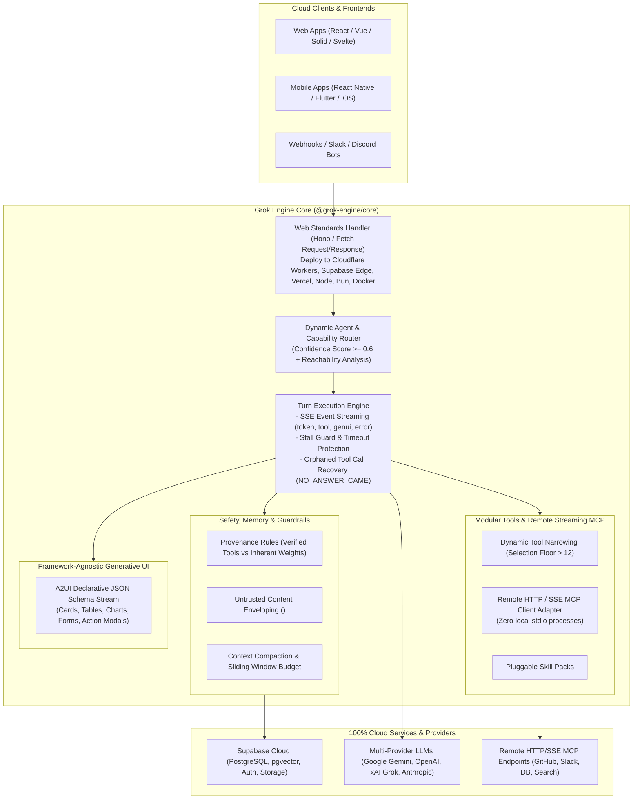

# Grok Engine (`@grok-engine/core`)

An ultra-modular, plug-and-play AI Agent Harness and Execution Engine designed for **100% cloud, serverless, and edge runtimes** with zero reliance on local laptop processes, local filesystem state, or local stdio binaries.

🤖 **For AI Agents**: Read [`AGENTS.md`](./AGENTS.md) for architectural contracts, recipes, and rules of engagement.  
📖 **For Developers**: Read [`docs/ARCHITECTURE_AND_INTEGRATION_GUIDE.md`](./docs/ARCHITECTURE_AND_INTEGRATION_GUIDE.md) for full technical handbook and sequence diagrams.

---

## 🌟 Core Architecture & Pillars



1. **Ultra-Modular Plug & Play**: Zero preloaded bloat. Register your own models, tools, skills, and memory backends dynamically.
2. **100% Cloud-First**: Built entirely on Web Standard `fetch` Request/Response (powered by Hono). Runs on Cloudflare Workers, Supabase Edge, Vercel, Node.js, Bun, or Docker.
3. **Cloud Database & Dual-Tier Memory (Supabase)**: Essential in-prompt facts within a byte budget + historical searchable memory queried via PostgreSQL FTS/pgvector.
4. **Remote HTTP/SSE Streamable MCPs Only**: Standard remote HTTP and Server-Sent Events (SSE) connections. **Zero local stdio child processes**.
5. **Anti-Hallucination & Injection Defense**:
   - `PROVENANCE_GUIDANCE`: Explicit citation rules (differentiating verified tool outputs vs general training weights).
   - `UNTRUSTED_GUIDANCE`: Enveloping external content inside `<untrusted_data>` with closing tag neutralization to block prompt injection.
   - `NO_ANSWER_CAME`: Synthetic tool resolution preventing stalled LLM state when actions are aborted.
6. **Dynamic Tool Narrowing (`SELECTION_FLOOR = 12`)**: Automatic 2-pass skill selection when tools exceed 12 to prevent context bloat and tool misfires.
7. **Framework-Agnostic Generative UI (GenUI / A2UI)**: Declarative JSON component streaming (Cards, Tables, Charts, Forms, Approval Modals) that any frontend can render.

---

## ⚡ Quick Copy-Paste Setup Commands

### 1. Install in your project
```bash
# Install @grok-engine/core directly from GitHub
npm install https://github.com/09062011/grok-engine.git#main

# Install required peer dependencies
npm install @supabase/supabase-js @google/genai hono zod

# (Optional) Dev dependencies for TypeScript & running scripts
npm install -D typescript @types/node tsx
```

### 2. Configure Environment (`.env`)
```bash
# Server Port
PORT=8080

# Gemini API Key (or OpenAI / xAI Grok)
GEMINI_API_KEY="AIzaSyYourGeminiApiKeyHere"

# Supabase Credentials (from Dashboard -> Settings -> API)
SUPABASE_URL="https://your-project.supabase.co"
SUPABASE_SERVICE_ROLE_KEY="eyJhbGciOiJIUzI1Ni..."
```

### 3. Run Supabase Database Migration
In your Supabase project, open the **SQL Editor** and run the contents of [`supabase/migrations/001_grokbot_tables.sql`](./supabase/migrations/001_grokbot_tables.sql) to set up threads, messages, and full-text search memories.

---

## 💻 Full Code Implementation Example

### `agent-service.ts` (Harness Setup)
```typescript
import {
  GrokHarness,
  GeminiProvider,
  SupabaseMemoryProvider,
  RemoteHttpMcpClient,
  A2UI
} from "@grok-engine/core";

// 1. Initialize Supabase Cloud Persistence
const memory = new SupabaseMemoryProvider({
  supabaseUrl: process.env.SUPABASE_URL!,
  supabaseKey: process.env.SUPABASE_SERVICE_ROLE_KEY!,
});

// 2. Initialize LLM Provider (Gemini / OpenAI / xAI Grok)
const model = new GeminiProvider({
  apiKey: process.env.GEMINI_API_KEY!,
  model: "gemini-2.5-flash",
});

// 3. Connect a Remote HTTP Streaming MCP (Zero local stdio)
const remoteSearch = new RemoteHttpMcpClient({
  name: "cloud_search",
  endpointUrl: "https://mcp.internal.cloud/api",
  headers: { Authorization: `Bearer ${process.env.MCP_TOKEN}` },
});

// 4. Assemble the Harness
export const harness = new GrokHarness({
  model,
  memory,
  tools: [
    // Define a custom GenUI tool that emits interactive components
    {
      name: "generate_sales_chart",
      description: "Generates an interactive sales chart",
      parameters: { type: "object", properties: {} },
      execute: async () => {
        return A2UI.chart({
          title: "Q3 Revenue Breakdown",
          chartType: "bar",
          labels: ["Jul", "Aug", "Sep"],
          series: [{ name: "Revenue ($k)", data: [120, 150, 190] }],
        });
      },
    },
  ],
  enableProvenanceGuidance: true,
  enableUntrustedEnveloping: true,
});

// Connect the remote MCP dynamically
await harness.connectMcp(remoteSearch);
```

### `server.ts` (Cloud Server Handler)
```typescript
import { serve } from "@hono/node-server";
import { createHarnessServer } from "@grok-engine/core";
import { harness } from "./agent-service.js";

const PORT = Number(process.env.PORT) || 8080;

const app = createHarnessServer({
  harness,
  corsOrigin: "*",
});

console.log(`Grok Engine server running on http://localhost:${PORT}`);
console.log(`Health endpoint: http://localhost:${PORT}/api/health`);
console.log(`Streaming chat endpoint: http://localhost:${PORT}/api/chat/stream`);

serve({ fetch: app.fetch, port: PORT });
```

---

## 📡 API Specification & cURL Testing

### Healthcheck
```bash
curl -X GET http://localhost:8080/api/health
```

### Stream Chat Turn (Server-Sent Events)
```bash
curl -N -X POST http://localhost:8080/api/chat/stream \
  -H "Content-Type: application/json" \
  -d '{"threadId": "demo-thread", "message": "Analyze Q3 sales and generate chart"}'
```

---

## 🚀 Cloud Deployment Commands

| Target Platform | Setup File | Deployment Command |
| :--- | :--- | :--- |
| **Supabase Edge Functions** | [`cloud-examples/supabase-edge/index.ts`](./cloud-examples/supabase-edge/index.ts) | `supabase functions deploy grok-engine --no-verify-jwt` |
| **Cloudflare Workers** | [`cloud-examples/cloudflare-worker/index.ts`](./cloud-examples/cloudflare-worker/index.ts) | `wrangler deploy cloud-examples/cloudflare-worker/index.ts` |
| **Docker (Railway / AWS / Fly)** | [`cloud-examples/docker/Dockerfile`](./cloud-examples/docker/Dockerfile) | `docker build -t grok-engine -f cloud-examples/docker/Dockerfile .` |
| **Node.js / Bun (Local / VPS)** | [`packages/cli`](./packages/cli) | `bun x @grok-engine/cli start` |

---

## 🧪 Automated Test Suite

Run the full automated test suite (28 passing unit & integration tests):

```bash
cd packages/engine
bun test
# or
pnpm test
```
