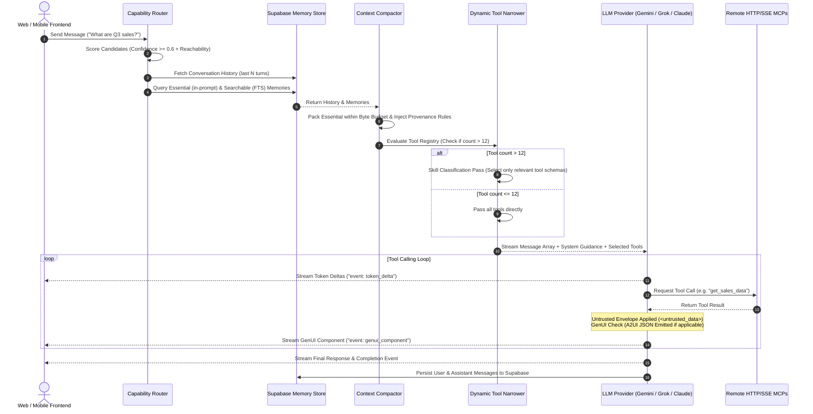

# Grok Engine: Architecture, Setup & Integration Handbook

This handbook provides the complete, production-grade guide to understanding, configuring, embedding, and deploying the **Grok Engine Harness** (`@grok-engine/core`) across your projects and cloud providers.

---

## Table of Contents
1. [Core Architecture Under the Hood](#1-core-architecture-under-the-hood)
2. [Complete Installation & Setup Commands](#2-complete-installation--setup-commands)
3. [Environment Configuration (`.env`)](#3-environment-configuration-env)
4. [Supabase Cloud Database & Memory Migration](#4-supabase-cloud-database--memory-migration)
5. [End-to-End Code Implementation](#5-end-to-end-code-implementation)
   - [5.1 Harness Initialization (`agent-service.ts`)](#51-harness-initialization-agent-servicets)
   - [5.2 Cloud API Server (`server.ts`)](#52-cloud-api-server-serverts)
   - [5.3 Frontend Streaming Client (`frontend-chat.ts` / React)](#53-frontend-streaming-client-frontend-chatts--react)
6. [Testing Your API with cURL & SSE](#6-testing-your-api-with-curl--sse)
7. [Cloud Deployment Commands](#7-cloud-deployment-commands)
   - [7.1 Supabase Edge Functions](#71-supabase-edge-functions)
   - [7.2 Cloudflare Workers](#72-cloudflare-workers)
   - [7.3 Docker (Railway, Fly.io, AWS)](#73-docker-railway-flyio-aws)
   - [7.4 Local Node.js / Bun](#74-local-nodejs--bun)
8. [Automated Test Suite](#8-automated-test-suite)

---

## 1. Core Architecture Under the Hood

When a prompt arrives from any frontend or webhook, the harness coordinates a 6-stage lifecycle:



### The 6 Core Subsystems
1. **Agent Router & Capability Classifier ([`classifier.ts`](../packages/engine/src/router/classifier.ts))**:
   - Matches not only role descriptions, but **the specific external systems each agent can reach** (`reaches: ["Salesforce", "Stripe"]`).
   - If confidence is $\ge 0.6$, routes to the specialist; otherwise, defaults safely without throwing.
2. **Anti-Hallucination Guardrails ([`rules/index.ts`](../packages/engine/src/rules/index.ts))**:
   - `PROVENANCE_GUIDANCE`: Forces the LLM to cite tool-read data and disclaim unverified figures, deadlines, or policies.
   - `UNTRUSTED_GUIDANCE`: Wraps outside data in `<untrusted_data source="...">` and escapes closing tags (`<\/untrusted_data>`) to block indirect prompt injection.
   - `NO_ANSWER_CAME`: Injects synthetic completions for aborted or un-replied tool calls to prevent broken assistant states.
3. **Dual-Tier Memory Budgeting ([`compactor.ts`](../packages/engine/src/memory/compactor.ts))**:
   - **Essential Memories**: Strict byte-budgeted facts (default 4096 bytes) prioritizing manual user rules over automatic observations.
   - **Searchable Memories**: Retrieved on-demand via PostgreSQL Full-Text Search (FTS) or pgvector similarity.
4. **Dynamic Tool Narrowing (`SELECTION_FLOOR = 12`) ([`narrower.ts`](../packages/engine/src/tools/narrower.ts))**:
   - When tools $\le 12$, offers all tools directly. When $> 12$, runs a pre-pass selecting matching skill bundles to prevent LLM misrouting. Fails open on ambiguity.
5. **Remote HTTP/SSE Streamable MCPs ([`http-mcp.ts`](../packages/engine/src/tools/http-mcp.ts))**:
   - Connects to remote Model Context Protocol servers over standard HTTP POST and Server-Sent Events (SSE). **Zero local stdio processes or binary dependencies**.
6. **Framework-Agnostic Generative UI (GenUI / A2UI) ([`genui/`](../packages/engine/src/genui/))**:
   - Emits declarative A2UI JSON components (`card`, `table`, `metric`, `chart`, `form`, `approval`) over SSE for live frontend rendering.

---

## 2. Complete Installation & Setup Commands

### Option A: Install from GitHub into your existing project
Run these commands in your project root:

```bash
# 1. Install @grok-engine/core from the GitHub repository
npm install https://github.com/09062011/grok-engine.git#main

# 2. Install peer dependencies
npm install @supabase/supabase-js @google/genai hono zod

# 3. (Optional) Install TypeScript & runtime dev dependencies
npm install -D typescript @types/node tsx
```

### Option B: Clone the complete Grok Engine repository
```bash
# Clone the repository
git clone https://github.com/09062011/grok-engine.git

# Enter the directory
cd grok-engine

# Install all monorepo dependencies with Bun or pnpm
bun install
# or
pnpm install

# Build the packages
bun run build
```

---

## 3. Environment Configuration (`.env`)

Create a `.env` file in your project root:

```bash
# Server Port (default: 8080 or 3060)
PORT=8080

# --- LLM Providers (Configure at least one) ---
# Google Gemini (Default recommended provider)
GEMINI_API_KEY="AIzaSyYourGeminiApiKeyHere"

# OpenAI / xAI Grok (Alternative provider)
OPENAI_API_KEY="sk-proj-YourOpenAIApiKeyHere"
# If using xAI Grok:
XAI_API_KEY="xai-YourGrokApiKeyHere"
MODEL_NAME="grok-beta"

# --- Supabase Cloud Persistence ---
SUPABASE_URL="https://your-project-id.supabase.co"
SUPABASE_SERVICE_ROLE_KEY="eyJhbGciOiJIUzI1NiIsInR5cCI6IkpXVCJ9..."

# --- Remote Streaming MCP Endpoints (Optional) ---
MCP_SEARCH_URL="https://mcp-search.mycloud.com/api"
MCP_SEARCH_TOKEN="bearer_token_if_protected"
```

---

## 4. Supabase Cloud Database & Memory Migration

1. Log into your [Supabase Dashboard](https://supabase.com/dashboard).
2. Open the **SQL Editor** on the left menu.
3. Paste and execute the SQL migration script from [`supabase/migrations/001_grokbot_tables.sql`](../supabase/migrations/001_grokbot_tables.sql).

---

## 5. End-to-End Code Implementation

### 5.1 Harness Initialization (`agent-service.ts`)

```typescript
import {
  GrokHarness,
  GeminiProvider,
  OpenAIProvider,
  SupabaseMemoryProvider,
  RemoteHttpMcpClient,
  A2UI
} from "@grok-engine/core";

// 1. Choose your Model Provider
const model = process.env.GEMINI_API_KEY
  ? new GeminiProvider({
      apiKey: process.env.GEMINI_API_KEY,
      model: "gemini-2.5-flash",
    })
  : new OpenAIProvider({
      apiKey: process.env.OPENAI_API_KEY || process.env.XAI_API_KEY,
      baseUrl: process.env.XAI_API_KEY ? "https://api.x.ai/v1" : undefined,
      model: process.env.MODEL_NAME || "gpt-4o",
    });

// 2. Connect Supabase Memory
const memory = new SupabaseMemoryProvider({
  supabaseUrl: process.env.SUPABASE_URL!,
  supabaseKey: process.env.SUPABASE_SERVICE_ROLE_KEY!,
});

// 3. Connect Remote HTTP/SSE Streamable MCP (Zero local stdio)
const remoteSearchMcp = new RemoteHttpMcpClient({
  name: "cloud_search",
  endpointUrl: process.env.MCP_SEARCH_URL || "https://mcp-search.mycloud.com/api",
  headers: process.env.MCP_SEARCH_TOKEN
    ? { Authorization: `Bearer ${process.env.MCP_SEARCH_TOKEN}` }
    : undefined,
});

// 4. Assemble the Harness
export const harness = new GrokHarness({
  model,
  memory,
  tools: [
    // Register custom GenUI tools
    {
      name: "generate_sales_chart",
      description: "Generates an interactive sales chart",
      parameters: { type: "object", properties: {} },
      execute: async () => {
        return A2UI.chart({
          title: "Q3 Departmental Revenue",
          chartType: "bar",
          labels: ["Engineering", "Marketing", "Sales", "Support"],
          series: [{ name: "Revenue ($k)", data: [210, 85, 340, 110] }],
        });
      },
    },
  ],
  enableProvenanceGuidance: true,
  enableUntrustedEnveloping: true,
});

// Load remote MCP tools into harness
await harness.connectMcp(remoteSearchMcp);
```

---

### 5.2 Cloud API Server (`server.ts`)

```typescript
import { serve } from "@hono/node-server";
import { createHarnessServer } from "@grok-engine/core";
import { harness } from "./agent-service.js";

const PORT = Number(process.env.PORT) || 8080;

const app = createHarnessServer({
  harness,
  corsOrigin: "*",
});

console.log(`Grok Engine server running on http://localhost:${PORT}`);
serve({ fetch: app.fetch, port: PORT });
```

---

### 5.3 Frontend Streaming Client (`frontend-chat.ts` / React)

```typescript
export async function streamChatTurn(
  apiUrl: string,
  threadId: string,
  userMessage: string,
  onToken: (text: string) => void,
  onGenUI: (component: any) => void
) {
  const response = await fetch(`${apiUrl}/api/chat/stream`, {
    method: "POST",
    headers: { "Content-Type": "application/json" },
    body: JSON.stringify({ threadId, message: userMessage }),
  });

  const reader = response.body!.getReader();
  const decoder = new TextDecoder();
  let buffer = "";

  while (true) {
    const { done, value } = await reader.read();
    if (done) break;

    buffer += decoder.decode(value, { stream: true });
    const events = buffer.split("\n\n");
    buffer = events.pop() || "";

    for (const raw of events) {
      if (!raw.startsWith("event: ")) continue;
      const [typeLine, dataLine] = raw.split("\n");
      const eventType = typeLine.replace("event: ", "").trim();
      const payload = JSON.parse(dataLine.replace("data: ", ""));

      if (eventType === "token_delta") {
        onToken(payload.text);
      } else if (eventType === "genui_component") {
        onGenUI(payload.component);
      }
    }
  }
}
```

---

## 6. Testing Your API with cURL & SSE

### Healthcheck:
```bash
curl -X GET http://localhost:8080/api/health
```

### Streaming Chat Turn (Server-Sent Events):
```bash
curl -N -X POST http://localhost:8080/api/chat/stream \
  -H "Content-Type: application/json" \
  -d '{"threadId": "demo-thread-1", "message": "Analyze sales and generate chart"}'
```

---

## 7. Cloud Deployment Commands

### 7.1 Supabase Edge Functions
```bash
supabase login
supabase link --project-ref your-project-id
supabase secrets set GEMINI_API_KEY="AIzaSy..."
supabase functions deploy grok-engine --no-verify-jwt
```

### 7.2 Cloudflare Workers
```bash
npm install -g wrangler
wrangler login
wrangler secret put GEMINI_API_KEY
wrangler deploy cloud-examples/cloudflare-worker/index.ts
```

### 7.3 Docker
```bash
docker build -t grok-engine -f cloud-examples/docker/Dockerfile .
docker run -p 8080:8080 -e GEMINI_API_KEY="AIzaSy..." grok-engine
```

---

## 8. Automated Test Suite

```bash
cd packages/engine
bun test
```
All 28 tests passing across rules, router, tools, memory, GenUI, and execution harness.
